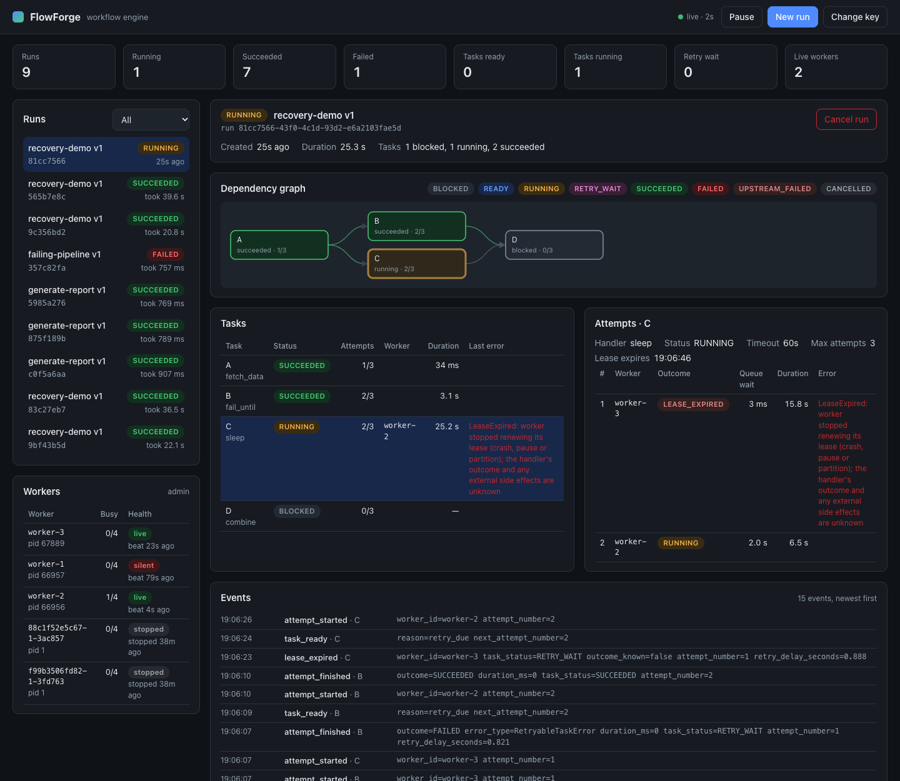
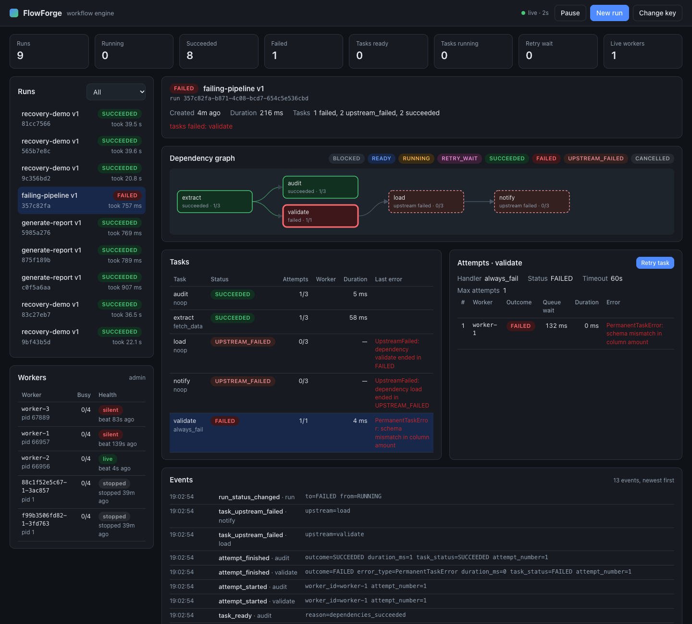

# FlowForge

FlowForge is a durable distributed workflow engine written in Python and backed by
PostgreSQL. You define workflows as DAGs of tasks and submit runs over a REST API.
Independent worker processes execute the tasks, under leases, with bounded retries,
lease-expiry recovery, fenced result commits, and idempotent submission.

> **Execution guarantee: durable, at-least-once.** The engine never accepts two results
> for the same attempt or two successes for the same task. A handler can still *run*
> more than once after a crash. If it calls an external system, it should use the
> operation key the engine provides. See [docs/failure-model.md](docs/failure-model.md).

This is an educational portfolio project. Every guarantee listed below is backed by an
automated test, and every number by a reproducible benchmark. Anything not tested is
listed as a limitation.

## Features

- **Workflow definitions**:
  - Versioned and immutable JSON DAGs.
  - Strict validation: schema, sizes, unique IDs, known handlers, dependency references,
    cycle detection (Hypothesis property tests).
- **Runs**:
  - Atomic creation of the run, its tasks, and its dependency edges.
  - Inputs and outputs: dependency outputs flow into downstream tasks, and the run
    output is the set of sink-task outputs.
  - Lifecycle timestamps and an append-only event log.
- **Independent workers**:
  - Transactional claiming with `FOR UPDATE SKIP LOCKED`.
  - One attempt record per claim, leases with heartbeats, fenced commits.
  - Graceful drain on SIGTERM.
  - Three handler isolation modes: async, thread, or a killable subprocess.
- **Scheduler**:
  - Promotes retries when they come due and recovers expired leases.
  - Reconciles runs as a safety net and samples queue gauges.
  - Stateless and safe to restart.
- **Retries**: max attempts, exponential backoff, a delay cap, jitter, `Retry-After`
  hints, retryable vs. permanent errors, timeouts, a dead-letter (FAILED) state, and
  admin-only manual retry.
- **Deadlines and queue timeouts**:
  - An optional workflow deadline (`deadline_seconds`) stops an overdue run and fails
    it.
  - An optional per-task queue timeout (`queue_timeout_seconds`) fails a task that no
    worker picks up in time.
  - See [`examples/deadline-workflow.json`](examples/deadline-workflow.json).
- **Failure propagation**: dependents of a failed task become `UPSTREAM_FAILED`.
  Independent branches still finish.
- **Cancellation**: queued work is cancelled atomically. Running handlers get
  cooperative cancellation, and the engine records the outcome that actually happened.
- **Retention** (opt-in): prune events of old finished runs, delete old finished runs
  with their history, and remove stale worker records, in small scheduler-driven
  batches.
- **Idempotent submission**: tenant-scoped keys, a request hash, safe under concurrency,
  409 on mismatch.
- **Security**: API keys with tenant isolation and roles, request-size limits, request
  timeouts, an optional rate limit, a registry of trusted handlers only, and no internal
  details in error responses.
- **Observability**:
  - JSON logs with correlation IDs: request, run, task, attempt, worker.
  - Prometheus metrics for queue depth, wait and execution latency, retries, leases,
    database latency, workers, and HTTP.
  - OpenTelemetry spans, with trace context propagated from the API to workers.
  - Health and readiness probes.
- **Dashboard** at `/ui`: live runs, an animated dependency graph, attempt history,
  events, worker health, and start / cancel / retry actions.
- **Operations**: Alembic migrations, Docker Compose, a `flowforge inspect` CLI,
  failure-injection points, a benchmark harness, and GitHub Actions CI.

## Architecture

```
            ┌──────────────┐ REST (X-API-Key)
 Client ───▶│  API (N×)    │──────────────┐
            └──────────────┘              ▼
            ┌──────────────┐       ┌──────────────┐
            │ Scheduler    │──────▶│  PostgreSQL  │  definitions · runs · tasks ·
            └──────────────┘       │ (source of   │  dependencies · attempts ·
            ┌──────────────┐       │  truth)      │  events · workers ·
            │ Worker (N×)  │──────▶│              │  idempotency records
            │  handlers    │       └──────────────┘
            └──────────────┘
```

**Task life cycle:**

1. The task is READY.
2. A worker claims it in one transaction: SKIP LOCKED, a new attempt, a lease.
3. The handler runs outside any transaction, while the worker renews the lease.
4. A fenced commit runs in one transaction: lock the task, verify the attempt token,
   write the outcome, lock the run, then promote dependents and finalise the run.

A crashed worker's lease expires. The scheduler records the attempt as `LEASE_EXPIRED`
(outcome unknown) and applies the retry policy.

- [docs/architecture.md](docs/architecture.md): components, transaction boundaries,
  locking, data model, security, observability.
- [docs/state-machines.md](docs/state-machines.md): task, attempt, and run states;
  cancellation and retry semantics.
- [docs/failure-model.md](docs/failure-model.md): guarantees, scenario-by-scenario
  behaviour, and limitations.
- [docs/failure-model-verification.md](docs/failure-model-verification.md): for each
  failure scenario, how it's induced, the evidence it happened, where the outcome is
  checked in PostgreSQL, and the mutation that proves the test catches it
  ([mutation-results.md](docs/mutation-results.md)).
- [docs/correctness-audit.md](docs/correctness-audit.md): every state transition, its
  lock and guard, a race matrix with tests, and global invariants checked after every
  test.
- [docs/decisions/](docs/decisions/): architecture decision records.
- [docs/benchmark-results.md](docs/benchmark-results.md): measured results and method.
- [docs/load-test-results.md](docs/load-test-results.md): sustained load with 3 APIs,
  2 schedulers and 6 workers, with a worker, a scheduler and an API process killed
  mid-load; overload behaviour; where the time goes.

## Quick start

Requirements: Docker, [uv](https://docs.astral.sh/uv/), and Python 3.12+ (uv can
install it). No cloud services are needed.

```bash
cp .env.example .env                       # development-only keys and settings
uv sync                                    # create .venv with pinned dependencies
docker compose -f deployments/docker-compose.yml up -d --wait postgres   # PostgreSQL 17 on :5433
uv run flowforge migrate                   # apply Alembic migrations
```

Run each component in its own terminal, or use `scripts/run-local.sh` to start them all:

```bash
uv run flowforge api --port 8000                       # http://127.0.0.1:8000/docs
uv run flowforge scheduler
uv run flowforge worker --concurrency 4 --worker-id worker-1
uv run flowforge worker --concurrency 4 --worker-id worker-2
```

To run the whole stack in containers instead:
`docker compose -f deployments/docker-compose.yml --profile app up --build`.

### Dashboard

Open **http://127.0.0.1:8000/ui/** and enter an API key (`dev-user-key`, or
`dev-admin-key` to also see workers and retry failed tasks). The page refreshes every
2 s and shows:

- runs by status, the live task queue, and worker health;
- each run's dependency graph, with nodes coloured by state as tasks move through
  BLOCKED → READY → RUNNING → SUCCEEDED;
- every attempt per task (worker, outcome, queue wait, duration, error) and the event
  timeline;
- buttons to start a run (or register a definition), cancel a run, and retry a failed
  task.



*Above: task C's first attempt on worker-3 ended `LEASE_EXPIRED` after the worker was
SIGKILLed, and attempt 2 is running on worker-2. D waits on C. Below: a failed run.
`validate` failed permanently, its dependents are `UPSTREAM_FAILED`, the independent
`audit` branch still finished, and an admin can retry.*



The dashboard is plain HTML, CSS and JavaScript shipped inside the package (no CDN, no
build step). It talks only to this API, keeps the key in `sessionStorage` for the tab,
and is served with a strict Content-Security-Policy. API data is never inserted as
HTML.

### Example API calls

```bash
H='X-API-Key: dev-user-key'

# 1. register a definition (201; re-posting identical content returns 200)
DEF=$(curl -s -H "$H" -H 'Content-Type: application/json' \
  -d @examples/report-workflow.json http://127.0.0.1:8000/v1/workflow-definitions | jq -r .id)

# 2. start a run idempotently (repeat -> 200 + same run; different body -> 409)
RUN=$(curl -s -H "$H" -H 'Content-Type: application/json' -H 'Idempotency-Key: report-2026-10-21' \
  -d '{"input": {"rows": 20}}' http://127.0.0.1:8000/v1/workflow-definitions/$DEF/runs | jq -r .id)

# 3. inspect
curl -s -H "$H" http://127.0.0.1:8000/v1/runs/$RUN | jq '{status, output, task_counts}'
curl -s -H "$H" http://127.0.0.1:8000/v1/runs/$RUN/tasks | jq '.items[] | {task_key, status, depends_on}'
TASK=$(curl -s -H "$H" http://127.0.0.1:8000/v1/runs/$RUN/tasks | jq -r '.items[0].id')
curl -s -H "$H" http://127.0.0.1:8000/v1/tasks/$TASK/attempts | jq
curl -s -H "$H" "http://127.0.0.1:8000/v1/runs/$RUN/events?limit=50" | jq '.items[].event_type'

# 4. control
curl -s -X POST -H "$H" http://127.0.0.1:8000/v1/runs/$RUN/cancel                 # 202
curl -s -X POST -H 'X-API-Key: dev-admin-key' http://127.0.0.1:8000/v1/tasks/$TASK/retry  # admin only

# 5. operations
curl -s -H "$H" http://127.0.0.1:8000/v1/stats                          # run / queue counts
curl -s -H 'X-API-Key: dev-admin-key' http://127.0.0.1:8000/v1/workers  # worker health (admin)
curl -s http://127.0.0.1:8000/health/ready
curl -s http://127.0.0.1:8000/metrics | grep flowforge_
uv run flowforge inspect $RUN            # attempt table straight from the database
```

Errors share one format:
`{"error": {"code": "...", "message": "...", "request_id": "...", "details": [...]}}`.

### Writing handlers

Handlers are trusted Python functions. Register them in a module and list that module
in `FLOWFORGE_HANDLER_MODULES`:

```python
from flowforge.domain.errors import PermanentTaskError, RetryableTaskError
from flowforge.worker.context import TaskContext
from flowforge.worker.registry import task_handler


@task_handler("charge_card", idempotent=False)
async def charge_card(ctx: TaskContext) -> dict:
    # ctx.operation_key is stable across retries -> use it as the provider's idempotency key
    resp = await payments.charge(amount=ctx.input["amount"], idempotency_key=ctx.operation_key)
    if resp.status == 429:
        raise RetryableTaskError("rate limited", retry_after_seconds=resp.retry_after)
    if resp.status == 400:
        raise PermanentTaskError("card declined")
    return {"charge_id": resp.id}
```

Use `isolation="process"` for CPU-bound or uninterruptible blocking code, so that a
timeout can kill it.

## Tests

```bash
uv run pytest -q                 # everything; global invariants are checked after every DB test
uv run pytest -q tests/unit      # no database needed
uv run python scripts/mutation_check.py   # remove each protection; its test must fail
uv sync --extra otel && uv run ruff check . && uv run ruff format --check . && uv run mypy
                                 # static checks (mypy --strict; the otel extra is type-checked too)
```

Integration tests create and recreate a dedicated database, `flowforge_test`, on the
Compose PostgreSQL at `localhost:5433`. Override it with `FLOWFORGE_TEST_DATABASE_URL`.
They never touch your working database. If PostgreSQL is unreachable, they are skipped
with an explicit reason. In CI they fail instead (`FLOWFORGE_REQUIRE_DB=1`).

| suite | what it proves |
|---|---|
| `tests/unit` | DAG validation and cycle detection (Hypothesis), retry delay bounds (Hypothesis), state-transition tables, error classification, configuration, handler registry, executor isolation and timeouts |
| `tests/integration/test_execution.py` | linear, diamond, and wide workflows; parallelism; retries; bounded attempts; failure propagation; permanent errors; timeouts (async and process) |
| `tests/integration/test_concurrency.py` | 30 concurrent claimers over 300 tasks (each claimed exactly once); 5 workers × 25 runs with no duplicate success; fan-in without write skew; 25 concurrent same-key submissions create one run |
| `tests/integration/test_reliability.py` | stale-worker rejection, lease expiry consuming attempts, scheduler recovery, cancellation (cooperative and uncooperative), manual retry, scheduler restart with RETRY_WAIT, reconciler |
| `tests/integration/test_api.py` | auth, roles, tenant isolation, validation errors, size limits, idempotency over HTTP, pagination, health, metrics labels, rate limit, database outage returning 503 |
| `tests/integration/test_schema.py` | `alembic check` (models match migrations), downgrade/upgrade round trip, CHECK, unique, and FK constraints, immutability triggers |
| `tests/integration/test_races.py` | two valid operations at once: completion, recovery, renewal, cancel, deadline, retry promotion, manual retry, two schedulers. Forced interleavings and randomized repetition |
| `tests/integration/test_reconnect.py` | a pooled connection the server killed while idle is retried once; real errors are not |
| `tests/integration/test_random_dags.py` | 8 seeded random DAGs with flaky tasks: no task starts before its dependencies succeed |
| `tests/failure/test_process_failures.py` | real processes: crash after claim, SIGKILL mid-task, crash after a side effect (duplicate vs. de-duplicated), SIGSTOP pause, missing heartbeats, graceful SIGTERM, scheduler SIGKILL and restart, short and long PostgreSQL outages, a lost COMMIT acknowledgement (TCP proxy), a scheduler restart during a partition, server-side session kills |

## Failure injection

```bash
scripts/run-local.sh          # terminal 1: API + scheduler + 2 workers
scripts/demo.sh               # terminal 2: run A -> (B, C) -> D, retry B, SIGKILL C's worker, show recovery

scripts/inject-worker-crash.sh worker-1            # SIGKILL a worker by id
FLOWFORGE_ENABLE_FAULT_INJECTION=true FLOWFORGE_FAULT_POINTS=crash_after_claim   uv run flowforge worker
FLOWFORGE_ENABLE_FAULT_INJECTION=true FLOWFORGE_FAULT_POINTS=crash_after_handler uv run flowforge worker
FLOWFORGE_ENABLE_FAULT_INJECTION=true FLOWFORGE_FAULT_POINTS=skip_heartbeats    uv run flowforge worker
kill -STOP <worker-pid>; sleep 20; kill -CONT <worker-pid>                     # pause past the lease
```

Fault points are inert unless `FLOWFORGE_ENABLE_FAULT_INJECTION=true`. Simulated
failures show the tested behaviour only. They do not prove every distributed failure is
handled safely.

## Benchmarks

```bash
uv run python scripts/benchmark.py            # full suite, 3 trials per configuration
uv run python scripts/benchmark.py --quick    # smaller, 1 trial
```

The harness recreates a separate `flowforge_bench` database and spawns real processes.
Raw JSON goes to `benchmarks/results/`.

Measured on an Apple A18 Pro laptop (6 cores), with PostgreSQL 17 in Docker Desktop
and every process on the same host. Handlers are no-ops, so these numbers measure engine
overhead. Full method, per-trial data, and caveats are in
[docs/benchmark-results.md](docs/benchmark-results.md).

| workload (3 trials each, burst) | workers × slots | tasks/s | queue wait p95 |
|---|---|---|---|
| linear chain of 10, 100 runs | 4 × 4 | 590–691 | 134–248 ms |
| fan-out of 50 + join, 20 runs | 4 × 8 | 421–552 | 1.2–2.1 s |
| random 20-task DAG, 100 runs | 4 × 4 | 573–662 | 0.44–0.62 s |
| 30 % transient failures with retries | 4 × 4 | 181–204 | 1.2–1.6 s |

- HTTP submission, 1 API process with 16 clients and a 20-task definition: 272–302
  runs/s, with p95 latency of 69–82 ms.
- Recovery from SIGKILL, from the kill until the task re-executes, with a 5 s lease:
  6.1–6.4 s.
- 28,560 of 28,560 tasks succeeded, with 0 duplicate accepted results.

**Sustained multi-process load** (3 APIs, 2 schedulers, 6 workers; a worker, a
scheduler and an API process each SIGKILLed during the load; details in
[docs/load-test-results.md](docs/load-test-results.md)):

| offered | result |
|---|---|
| 200 tasks/s for 210 s | 42,000 tasks; 0 lost, 0 duplicated, 0 invariant violations; queue wait p95 18 ms, run p95 125 ms; recovery from the worker kill 11.3 s (10 s lease) |
| 720 tasks/s (overload) | throughput holds at 465–490 tasks/s and the excess queues (queue age max 5.2 s); 0 lost or duplicated |

Profiling under load drove three fixes:

- ADR 0011: fewer database round trips per task.
- ADR 0012: plans that don't depend on stale planner statistics.
- ADR 0016: no stale cached plans. This stopped throughput from collapsing under
  overload, from 527 down to 212 tasks/s before the fix, at a measured cost of 5–7%
  peak throughput.

All numbers come from one laptop with everything on the same host. Multi-host
deployments and PostgreSQL failover are untested.

## Configuration

All settings are environment variables with the `FLOWFORGE_` prefix (see
`src/flowforge/config.py` and `.env.example`). The most important ones:

| variable | default | meaning |
|---|---|---|
| `DATABASE_URL` | `postgresql+asyncpg://…:5433/flowforge` | PostgreSQL DSN |
| `API_KEYS` | (empty) | `key:tenant:role,…`, where role is `user` or `admin` |
| `HANDLER_MODULES` | `flowforge.handlers.builtin` | modules that register handlers |
| `LEASE_SECONDS` / `HEARTBEAT_INTERVAL_SECONDS` | 15 / 5 | lease length and renewal period |
| `WORKER_POLL_INTERVAL_SECONDS` / `WORKER_MAX_POLL_INTERVAL_SECONDS` | 0.5 / 2 | idle polling backoff |
| `SCHEDULER_INTERVAL_SECONDS` | 1 | scheduler cycle |
| `WORKER_SHUTDOWN_GRACE_SECONDS` | 30 | drain time on SIGTERM |
| `MAX_REQUEST_BYTES` / `MAX_JSON_VALUE_BYTES` | 1 MiB / 256 KiB | request size and input/output limits |
| `RUN_SUBMIT_RATE_PER_SECOND` | off | per-tenant submission limit (per API process) |
| `METRICS_PORT` | off | Prometheus port for the worker and scheduler |
| `EVENT_RETENTION_DAYS` | off | delete events of runs finished longer ago (runs, tasks, attempts kept) |
| `RUN_RETENTION_DAYS` | off | delete runs finished longer ago, with all their history; this is also the idempotency-key window |
| `WORKER_RETENTION_HOURS` | 168 | remove stopped or silent workers from the registry |

## Known limitations

These are explained in detail in [docs/failure-model.md](docs/failure-model.md).

- At-least-once execution. External exactly-once needs downstream idempotency or
  fencing.
- Recovery after a crash takes about one lease duration (15 s by default).
- Completions within one run are serialised by the run lock, which limits very wide
  single runs.
- Thread handlers cannot be interrupted. A timed-out thread keeps a worker slot until
  it returns.
- Not implemented: compensation/sagas, scheduled or
  recurring workflows, partitioning of the event table, a global rate limiter.
- Tested on one host, with PostgreSQL in Docker. No multi-host partitions and no
  PostgreSQL failover.

## Future extensions

These are deliberately deferred until measurements justify them:

- LISTEN/NOTIFY to reduce polling latency.
- Batch completions.
- Event table partitioning, if retention deletes ever become a measured cost.
- Compensation steps.
- Per-tenant fairness and quotas.
- A typed client SDK.

## Repository layout

```
src/flowforge/      application package (api, engine, worker, scheduler, domain, db, observability)
migrations/         Alembic migrations
tests/              unit, integration, concurrency, failure-injection tests (+ support helpers)
examples/           sample workflow definitions
scripts/            run-local.sh, demo.sh, inject-worker-crash.sh, benchmark.py
docs/               architecture, state machines, failure model, benchmark results, ADRs
deployments/        docker-compose.yml, Dockerfile
.github/workflows/  CI (lint, mypy, migrations, full test suite, benchmark smoke run)
```
