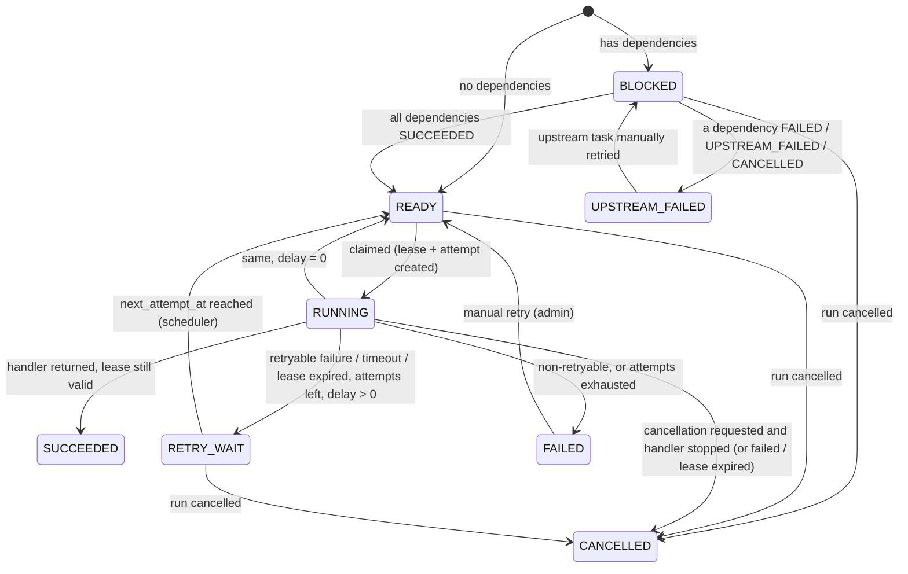
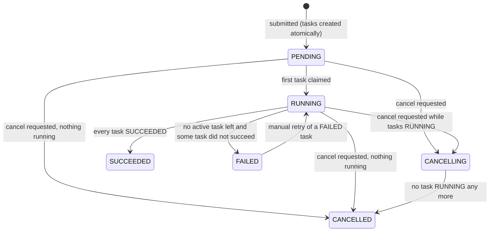

# State machines

These transitions are defined once, in `src/flowforge/domain/states.py`, and checked in
code. Database CHECK constraints reinforce them: valid values, `RUNNING` ⇔ a lease
exists, `RETRY_WAIT` ⇒ `next_attempt_at`, terminal ⇔ `completed_at`, and
`attempt_count <= attempt_limit`. API clients can never set a state directly.

## Task states



| state | meaning | terminal |
|---|---|---|
| BLOCKED | at least one dependency has not succeeded | no |
| READY | claimable; `ready_at` is when it became claimable (queue-wait start) | no |
| RUNNING | a worker holds a lease: `lease_owner`, `lease_expires_at`, `current_attempt_id` | no |
| RETRY_WAIT | will become READY at `next_attempt_at` | no |
| SUCCEEDED | output persisted by the attempt that held the lease | yes |
| FAILED | non-retryable error or attempt budget exhausted (dead-letter) | yes* |
| UPSTREAM_FAILED | can never run because a dependency did not succeed | yes* |
| CANCELLED | cancelled before or during execution | yes |

\* Only an authorised manual retry can re-open these states.

## Attempt outcomes

Each claim creates one `task_attempts` row, numbered 1, 2, 3, and so on. The number is
the fencing generation. Possible outcomes:

- `RUNNING`: the attempt is in progress.
- `SUCCEEDED`, `FAILED`, `TIMED_OUT`, `CANCELLED`: reported by the worker that held the
  lease.
- `LEASE_EXPIRED`: written by the scheduler. It means the worker stopped renewing, and
  **whether the handler ran or caused side effects is unknown**.

## Run states



### Completion rules

These are evaluated under the run-row lock (ADR 0005) after every terminal task change.

- **SUCCEEDED:** every task is SUCCEEDED. The run output is `{task_key: output}` for the
  *sink* tasks, meaning tasks that nothing depends on.
- **FAILED:** no task is BLOCKED, READY, RUNNING, or RETRY_WAIT, and at least one is
  FAILED, UPSTREAM_FAILED, or CANCELLED. `failure_reason` lists the FAILED tasks.
  Independent branches run to completion first.
- **CANCELLED:** the run is CANCELLING and no task is RUNNING.

## Cancellation semantics

`POST /v1/runs/{id}/cancel` does the following:

1. In one transaction, it locks the run and sets it to CANCELLING. It immediately sets
   every BLOCKED, READY, or RETRY_WAIT task to CANCELLED, and records a
   `task_cancel_requested` event for every RUNNING task. Tasks that were READY at that
   moment can no longer be claimed. RUNNING rows are deliberately not written: that
   would invert the engine's lock order (ADR 0005). Workers read the run status
   instead.
2. If nothing is RUNNING, the run becomes CANCELLED in the same transaction.
3. Otherwise each worker sees the request on its next heartbeat, because lease
   renewal returns `run.status = 'CANCELLING'`. The default heartbeat
   interval is 5 s. The worker sets the handler's cancel flag, and what happens next
   depends on isolation mode (ADR 0008):
   - `async`: the handler is interrupted at its next await.
   - `process`: the subprocess is terminated.
   - `thread`: the worker waits for the handler, because a thread cannot be stopped.
4. What gets recorded depends on how the attempt ends:
   - The handler stopped: the attempt is recorded `CANCELLED`.
   - The handler finished successfully anyway: the attempt is recorded `SUCCEEDED`. That
     is the truth, and the work was done.
   - The handler failed: the attempt is recorded `FAILED`. A pending retry is turned
     into CANCELLED under the run lock.
   - In every case the task does not retry, and its dependents are not started.
5. When the last RUNNING task settles, the run becomes CANCELLED. A worker that died
   during cancellation is covered by lease expiry, which sets the task to CANCELLED.

Cancelling a terminal run returns 409. Cancelling a run that is already CANCELLING is
idempotent and returns 202.

## Retry and backoff

Delays are computed per task with `RetryPolicy` (`src/flowforge/domain/retry.py`):

```
delay  = min(max_delay, initial_delay * multiplier^(attempt - 1))
actual = delay - delay * jitter_ratio * U[0,1)          # jitter only shortens
actual = max(actual, min(retry_after, max_delay))       # Retry-After hint, capped
```

Delays are always within `[0, max_delay_seconds]`. Hypothesis checks this property over
arbitrary policies. The retry decision works as follows:

- The failure is not retryable if it is a `PermanentTaskError`, an input validation
  error, an error type listed in `non_retryable_errors`, or a timeout when
  `retry_on_timeout=false`. Other exceptions are retryable.
- A retryable failure is retried only while `attempt_count < attempt_limit`.
- Otherwise the task becomes FAILED.
